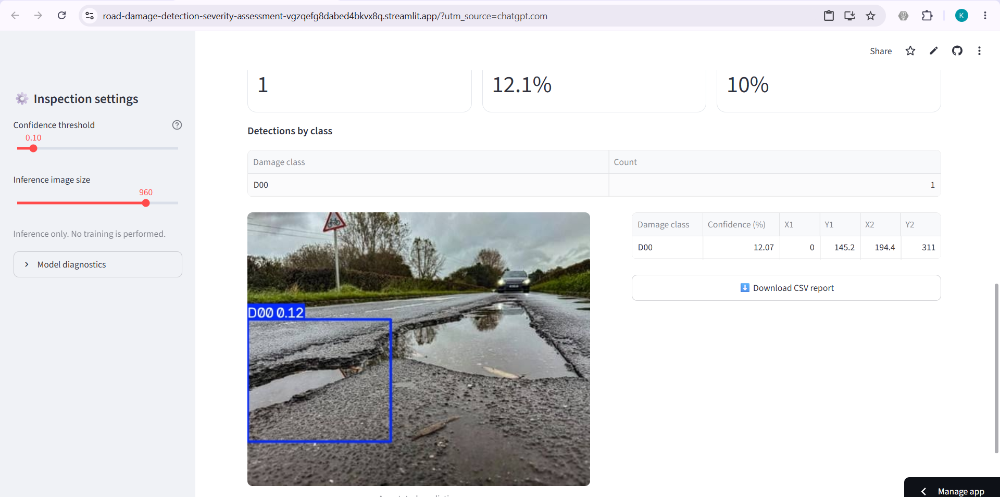
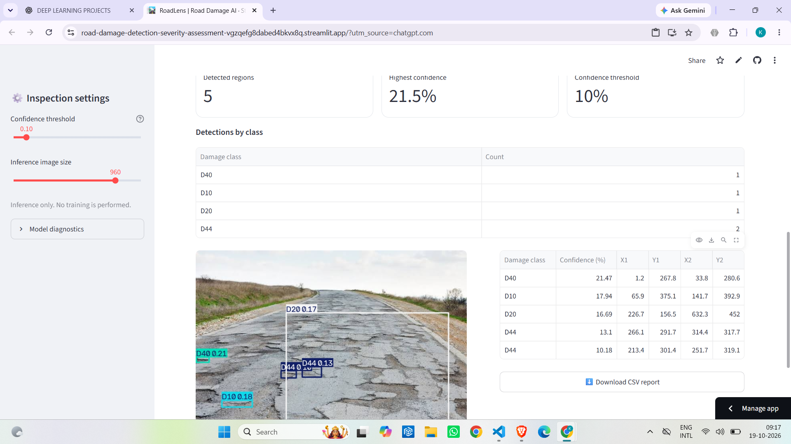

# 🛣️ RoadLens — Road Damage Detection & Severity Assessment Using Deep Learning

An AI-powered computer vision application for detecting road-surface damage from images using a trained YOLO object-detection model.

[](https://road-damage-detection-severity-assessment-vgzqefg8dabed4bkvx8q.streamlit.app/)
[](https://huggingface.co/spaces/beingkarthik/roadlens-road-damage)
[](https://www.python.org/)
[](https://streamlit.io/)

## 🚀 Live Application

Try RoadLens: [Launch the live application](https://road-damage-detection-severity-assessment-vgzqefg8dabed4bkvx8q.streamlit.app/)

Project website: [Visit RoadLens on Hugging Face](https://huggingface.co/spaces/beingkarthik/roadlens-road-damage)

RoadLens provides a web interface for uploading road images, running inference with an existing trained model, and reviewing the resulting predictions.

## 📸 Application Screenshots

### Road Damage Detection



### Multiple Damage Detections



## 📌 Project Overview

Road damage can affect road quality, vehicle safety, and maintenance planning. Manually inspecting large road networks is time-consuming and difficult to scale.

RoadLens explores how deep learning and computer vision can assist visual road inspection by detecting damage patterns in road images.

The application uses a trained YOLO model to identify configured road-damage classes and display predicted locations, class labels, and confidence scores.

### Problem Statement

Manual road inspection requires time and human effort, while road damage can vary in shape, size, and appearance. This project aims to develop an image-based detection system that assists inspectors by automatically identifying potential road damage in uploaded images.

### Project Objectives

- Detect configured road-damage patterns in images.
- Visualize predicted damage locations using bounding boxes.
- Display predicted classes and confidence scores.
- Provide an interactive web interface for model inference.
- Make the trained model accessible through a deployed application.

## ✨ Features

- Image upload for supported road images.
- AI-powered detection using a trained YOLO model.
- Bounding-box visualization of predicted damage.
- Adjustable confidence threshold and inference image size.
- Inspection of predicted labels and confidence values.
- CSV report download where supported by the application.
- Online deployment through Streamlit Community Cloud.
- Project landing page hosted on Hugging Face Spaces.

## 🧠 Model Information

The application uses the existing trained YOLO checkpoint:

`models/completed_30_epochs_last.pt`

The configured class mapping is:

| Class ID | Label |
|---|---|
| 0 | D00 |
| 1 | D10 |
| 2 | D20 |
| 3 | D40 |
| 4 | D44 |

The class descriptions should follow the annotation definitions used in the dataset. Predictions depend on the training data, image quality, camera viewpoint, lighting, and inference settings.

No retraining is performed when a user uploads an image. The application uses the existing checkpoint for inference.

## ⚙️ Technology Stack

| Technology | Purpose |
|---|---|
| Python | Application and inference logic |
| YOLO / Ultralytics | Object detection |
| PyTorch | Deep-learning model execution |
| Streamlit | Interactive web interface |
| OpenCV | Image processing |
| Pillow | Image loading and handling |
| Pandas | Tabular data and report handling |
| Git and GitHub | Version control and source hosting |
| Hugging Face Spaces | Static project landing page |
| Streamlit Community Cloud | Live application deployment |

## 🏗️ Application Workflow

```text
Road Image
    |
    v
Image Upload
    |
    v
Image Validation and Preprocessing
    |
    v
Trained YOLO Model
    |
    v
Road-Damage Predictions
    |
    v
Bounding Boxes, Labels and Confidence Scores
    |
    v
Results and Available Downloads
```

## 🖥️ Run Locally

### 1. Clone the repository

```bash
git clone https://github.com/Beingkarthik/Road-Damage-Detection-Severity-Assessment.git
cd Road-Damage-Detection-Severity-Assessment
```

### 2. Create a virtual environment

For Windows:

```cmd
python -m venv .venv
.venv\Scripts\activate
```

### 3. Install dependencies

```bash
python -m pip install --upgrade pip
pip install -r requirements.txt
```

### 4. Verify the trained model

Ensure the checkpoint exists at:

```text
models/completed_30_epochs_last.pt
```

### 5. Start the application

```bash
streamlit run app.py
```

Open the local URL printed in the terminal, typically:

http://localhost:8501

Note: Local execution requires compatible Python packages and the trained model file. Dependency compatibility may vary between local and cloud environments.

## 📁 Project Structure

```text
Road-Damage-Detection-Severity-Assessment/
├── app.py
├── requirements.txt
├── packages.txt
├── README.md
├── models/
│   └── completed_30_epochs_last.pt
├── data/
│   └── raw/
│       └── RDD2022/
├── notebooks/
├── src/
│   ├── main.py
│   ├── train.py
│   ├── train_improved.py
│   └── check_dataset.py
├── sample_test_images/
├── screenshots/
│   ├── roadlens-detection-result.png
│   └── roadlens-multiple-detections.png
├── evaluation_results/
│   ├── metrics.txt
│   ├── confusion_matrix.png
│   ├── confusion_matrix_normalized.png
│   ├── BoxF1_curve.png
│   ├── BoxP_curve.png
│   ├── BoxPR_curve.png
│   └── BoxR_curve.png
├── runs/
└── evaluate_model.py
```

This is a representative layout. Some folders may contain additional files or may vary depending on the local project state.

## 🧪 Testing and Evaluation

The trained model was evaluated on the held-out test split of the RDD2022 dataset using CPU inference.

### Test Dataset

| Evaluation detail | Result |
|---|---:|
| Dataset | RDD2022 |
| Test images | 5,758 |
| Ground-truth instances | 9,675 |
| Evaluation device | CPU |
| Model checkpoint | completed_30_epochs_last.pt |

### Quantitative Results

| Metric | Result |
|---|---:|
| Precision | 55.27% |
| Recall | 51.86% |
| mAP@50 | 51.66% |
| mAP@50–95 | 26.07% |

The metrics are from the current checkpoint evaluated on the held-out test split. They represent the measured results of this model and should not be interpreted as a guarantee of performance on every road image.

The `evaluation_results/` directory contains the evaluation summary, confusion matrices, metric curves, and prediction-versus-label visualizations.

### Recommended Application Checks

- Confirm that the model loads successfully.
- Upload a valid road image.
- Inspect predicted labels and bounding boxes.
- Test different confidence thresholds.
- Compare predictions on multiple sample images.
- Verify available report downloads.
- Test the deployed application after code changes.

## ⚠️ Limitations

- Predictions are limited to patterns represented in the training data.
- Poor lighting, unusual camera angles, low image quality, and unfamiliar road surfaces can affect results.
- False positives and missed detections are possible.
- A low confidence threshold may increase both detections and false positives.
- The model's outputs are not a certified assessment of road safety or damage severity.
- A missing detection does not establish that a road is undamaged.

RoadLens is a prototype intended to assist visual inspection and demonstrate deep-learning-based road damage detection.

## 👥 Contributors

This project was developed collaboratively by:

1. Nanavath Karthik
2. Bendi Kushwanth
3. Shruthika

## 🔮 Future Improvements

- Investigate methods to improve detection performance and generalization.
- Evaluate performance across different road, lighting, and weather conditions.
- Explore additional damage categories and severity estimation.
- Expand batch-image processing and reporting capabilities.
- Improve automated testing, documentation, and deployment monitoring.

## 📄 License

No license is currently specified in this README. Before redistributing or reusing the project, add a `LICENSE` file that reflects the contributors' chosen licensing terms and any applicable dataset or model restrictions.

---

RoadLens — Deep learning for smarter road inspection.
